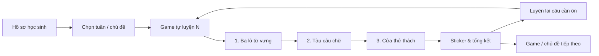

# Bộ game dùng chung — Ms. Trang Trieu Education

## Mở rộng tháng 10/2026
Đã bổ sung game 2–15 và bản đồ rừng tại `../hanh-trinh/`. Bộ máy đa trò chơi, nội dung và hướng dẫn biên tập nằm trong `adventures/README.md`. Các mục bên dưới mô tả bộ khung ba màn của game 1; không phải giới hạn của các game mới. Giao diện rừng và cô giáo Cáo mặc đồng phục được dùng chung qua `adventures/forest.css`. Tổng hành trình có 12 game theo tuần và 3 game tổng ôn, mở khóa tuần tự, chấm 1–3 sao khi hoàn thành.

## Kiến trúc
- `engine.js`: kéo thả/chạm, chấm đáp án, đọc câu hỏi, combo, sticker, lưu bài dở dang, đếm ngược và thi thử.
- `style.css`, `assets/`: giao diện 3D, Titi được duyệt, hình ba lô/tàu/cửa, font tiếng Việt. Sửa một lần cho tất cả game.
- `profile.js`: tên học sinh từ hồ sơ, vùng lưu riêng theo học sinh và game.
- Mỗi thư mục `tu-luyen-N/` chỉ có `config.js`, `data.js`, các bản ghi âm và HTML nạp bộ khung chung.
- `tu-luyen-1/mini.js`, `mini.css`, `profile.js` và tài nguyên cũ được giữ để tương thích liên kết đã cache; trang hiện tại dùng `game-kit/`. Không sửa bản cũ để phát triển mới.

## Tạo game mới
Chạy từ thư mục gốc repository:

```sh
node game-kit/tools/create-game.cjs tu-luyen-2 "ÔN THI VĂN LANG - TIẾNG ANH - GAME TỰ LUYỆN 2"
node game-kit/tools/validate.cjs tu-luyen-2 --audio-manifest
python -m pip install edge-tts==7.3.1
python game-kit/tools/build-audio.py tu-luyen-2
node game-kit/tools/validate.cjs tu-luyen-2 --strict-audio
```

Lệnh tạo không ghi đè thư mục có sẵn. Nội dung tạo ra là bản mẫu cần thay bằng đề đã duyệt; không tự xuất bản. Có thể chạy lệnh cho nhiều mã game, nhưng phải kiểm tra từng bộ câu hỏi và giọng đọc trước khi đưa lên GitHub Pages. Trình duyệt chỉ cần HTML/JS/CSS/MP3/WebP; Python chỉ dùng lúc chuẩn bị audio, không có backend khi chơi.

## Quy tắc nội dung
Bản đầu hỗ trợ đúng ba màn `words`, `sentences`, `mission`: ba lô → tàu → cửa. Mỗi màn 1–12 bài. Có 6 loại bài: `pack`, `match`, `sort`, `order`, `choice`, `repair`. ID câu phải duy nhất. Đáp án lựa chọn phải nằm trong options. `order` dùng token duy nhất (gộp thành cụm nếu lặp từ), xuất hiện ở màn tàu/cửa. `scene` chỉ dùng chữ, `<br>`, `<strong>`.

Thẻ hồ sơ dùng `profileCard: {title, fields: [[label, value], ...]}` để tự bố trí, không viết riêng tên Titi trong engine. Giữ `scene` tương ứng để đọc audio. Dùng `spokenScene` cho cách đọc đúng ngữ cảnh, ví dụ nhãn `Lives in: Ha Noi` đọc `He lives in Hanoi.`. `audio-manifest.json` tách chữ hiển thị (`key`) khỏi lời đọc (`text`); xem lại live/lives/read, số giờ, tên riêng trước khi tạo bản ghi. Không làm lệch ý câu hỏi/đáp án.

`storageKey` không đổi cho game cũ, khác nhau giữa các game mới. `timeLimitSeconds` mặc định 600. `examMode:false` cho luyện không giới hạn. Học sinh có thể đổi chế độ ở bản đồ. Đồng hồ tiếp tục khi ẩn tab; chọn lưu về bản đồ tạm dừng, mở lại dùng thời gian còn lại. Đây là luyện thi, không phải hệ thống chống gian lận hay chấm thi có máy chủ.

## Kịch bản tương tác
1. Chọn màn → đếm 5–4–3–2–1 → bắt đầu bài và đồng hồ.
2. Đọc tình huống bằng giọng nữ → tự hiện câu hỏi lớn → đọc câu hỏi; không có nút Show question.
3. Play/Pause điều khiển phần đang đọc; sóng âm chuyển động khi phát. Tắt tiếng vẫn cho làm bài.
4. Nhấc thẻ: pop, thẻ nổi; đưa gần đích: ba lô phồng sáng; thả đúng: ding, sao, Titi mừng; sai: rung nhẹ, Try again, đưa vào luyện lại.
5. Đúng liên tiếp không dùng gợi ý: combo; tăng điểm: huy chương lấp lánh. Xong màn: hợp âm, confetti, mở rương nhận sticker.
6. Rời bài: chọn chơi tiếp hoặc lưu về bản đồ. Hết giờ: Titi mời luyện tiếp không giờ hoặc làm lại.
7. Tôn trọng reduced-motion; không dịch chuyển vùng thả liên tục. Dọc điện thoại cuộn tự nhiên, ngang giữ khung 16:9.

## Bản đồ hành trình
Hiện tại ba thẻ màn được nối thành đường đi, mở tự do để giáo viên chọn phần cần luyện. Đề xuất mở rộng khi có nhiều game:



Chưa tự khóa màn hay tự tạo hàng loạt đề chưa được duyệt. Bản đồ nhiều game là bước kế tiếp sau khi có danh sách chủ đề.

## Kiểm tra trước xuất bản
Chạy validator và strict-audio; kiểm tra không lộ đáp án trong tiêu đề, đề/giải thích nhất quán, nghe bản thu có từ dễ đọc nhầm. Thử chuột và chạm ở 390×740, 844×390, 1280×720; Play/Pause, tắt tiếng, đổi câu khi đang đọc, quay lại bài dở, hết giờ, giảm chuyển động. Kiểm tra đường dẫn tương đối dưới GitHub Pages. Đổi version query khi thay mã chung để tránh cache cũ.
